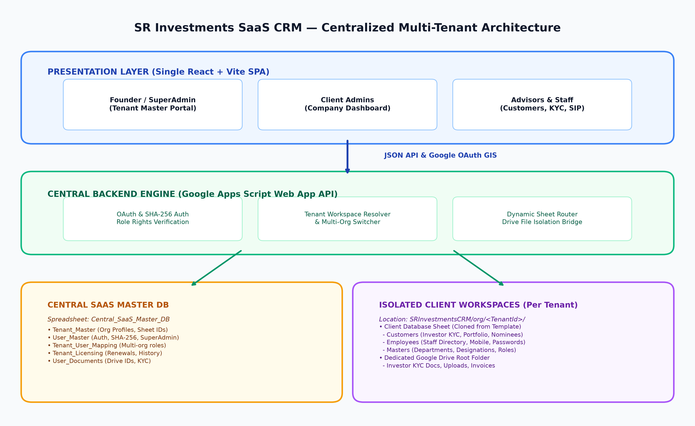

# Project Architecture & Technical Specification

**Document ID:** `ARCH-CRM-SAAS-01`  
**Version:** `v2.5 (Production Live)`  
**Format:** Markdown Companion (Full Word document: [`03_Project_Architecture_And_Flow.docx`](./03_Project_Architecture_And_Flow.docx))

---

## 1. High-Level Architecture Diagram

---

## 2. Architectural Layers

### Layer 1: Presentation Layer (React 18 + Vite SPA)
- Deployed via CDN / GitHub Pages as a single static bundle.
- State-managed session via `AuthContext.jsx`.
- Dynamic theme (Royal Blue) and permission-based UI rendering.
- Role-based rights matrix enforcement on the client.

### Layer 2: Central Backend Engine (Google Apps Script Web App)
- REST/JSON RPC microservice running on Google infrastructure.
- Zero-CORS dual bridge transport (Direct fetch + iframe postMessage bridge).
- Endpoints for `login`, `googleLogin`, `selectTenant`, `getTenants`, `saveTenant`, `saveTenantLicense`, etc.

### Layer 3: Storage Layer (Centralized vs Isolated)

#### Central SaaS Master DB (`Central_SaaS_Master_DB`)
- `Tenant_Master`: Company profiles, ARN codes, `SpreadsheetId`, `DriveRootFolderId`.
- `User_Master`: Global user registry, SHA-256 hashed passwords, `IsSuperAdmin`.
- `Tenant_User_Mapping`: M:N association mapping users to tenants with specific roles.
- `Tenant_Licensing`: Subscription validity, commercial fees, renewal histories.
- `User_Documents`: Cross-tenant document indexes and KYC references.

#### Isolated Client Workspaces (`org/<ClientName>/`)
- Dedicated spreadsheet cloned from `_CRM_DATABASE_TEMPLATE`.
- Contains `Customers` (Investor KYC, Portfolio, Nominees) and `Employees` (Staff Directory).
- Dedicated Drive folder ID ensuring full file isolation.

---

## 3. 7-Field Enterprise Audit Standard

Every table across all databases enforces 7 standardized audit columns:
1. `IsDeleted` (BOOLEAN): Soft deletion flag.
2. `Created_By` (STRING): Email of creating user.
3. `Created_At` (TIMESTAMP): ISO-8601 creation time.
4. `Updated_By` (STRING): Email of last modifying user.
5. `Updated_At` (TIMESTAMP): ISO-8601 last update time.
6. `Deleted_By` (STRING): Email of deleting user.
7. `Deleted_At` (TIMESTAMP): ISO-8601 deletion time.

