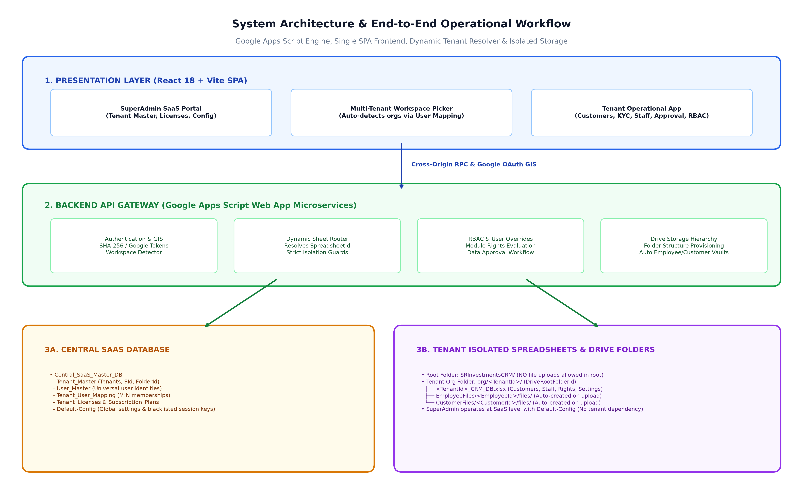
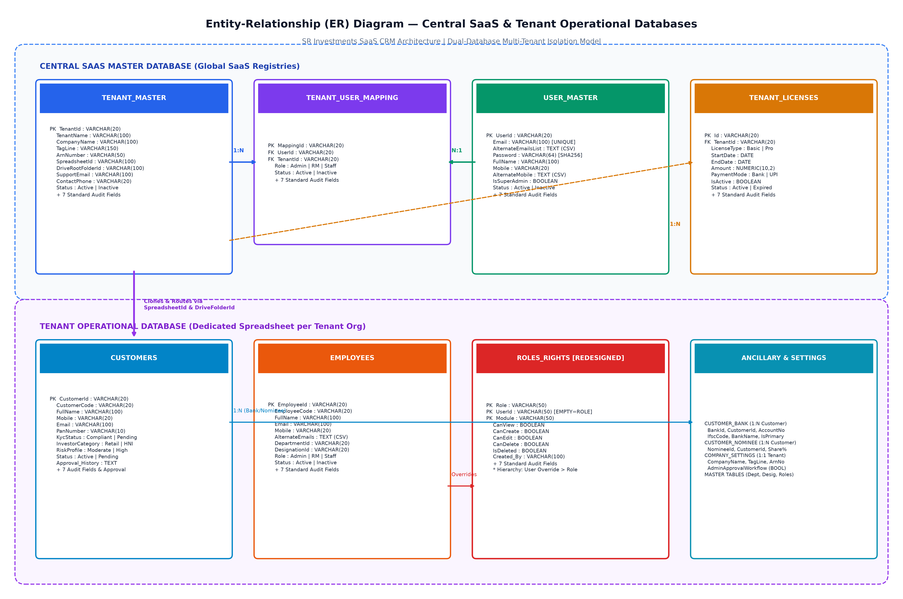
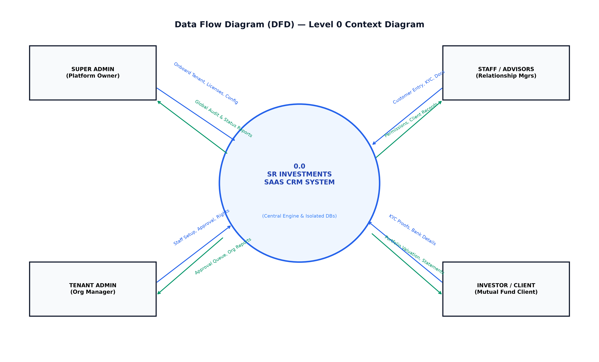
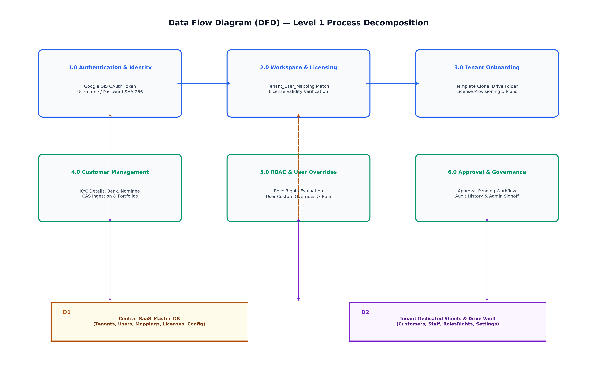

# DFD, Entity-Relationship (ER) & Workflow Documentation

**Document ID:** `DIAG-CRM-SAAS-02`  
**Version:** `v3.0 (Production Live)`  
**Format:** Markdown Companion  
**Primary Word Documents (.docx):**
- [`CRM_Complete_Architecture_Workflow_ERD_DFD.docx`](./CRM_Complete_Architecture_Workflow_ERD_DFD.docx)
- [`04_DFD_And_ER_Diagrams.docx`](./04_DFD_And_ER_Diagrams.docx)

---

## 1. High-Level Architecture & End-to-End Workflow



### Key Workflows:
1. **Multi-Tenant SaaS Provisioning:**
   - Template cloning creates isolated `<TenantId>_CRM_DB` spreadsheet per tenant org.
   - Dedicated folder generated in Google Drive: `SRInvestmentsCRM/org/<TenantId>/`.
   - Automatic subdirectories created on first upload: `EmployeeFiles/<EmployeeId>/files/` and `CustomerFiles/<CustomerId>/files/`.
   - SuperAdmin operates at SaaS level with `Default-Config` without tenant dependency; no file uploads allowed in root folder.
2. **Dual Authentication & Workspace Routing:**
   - Google Identity Services (GIS) OAuth 2.0 with interactive Account Chooser (`prompt='select_account'`).
   - Traditional credentials login (Staff ID / Email / Mobile + SHA-256 password).
   - If user belongs to multiple organizations in `Tenant_User_Mapping`, renders interactive Workspace Picker.
3. **Data Governance & Admin Approval Workflow:**
   - When enabled in `CompanySettings`: Any non-admin add, edit, or delete is marked with `Status = 'Approval Pending'`.
   - Non-admin changes remain pending until an Admin reviews and approves/rejects them.
4. **Hybrid Permissions (RBAC + Specific User Customization):**
   - **Role Baseline:** Privileges defined for a Role apply to all users assigned to that role (`UserId` is empty).
   - **User Custom Override:** Privileges customized for a specific user (`UserId` populated).
   - **Reset to Role Defaults:** One-click reset clears custom user records and restores role baseline inheritance.

---

## 2. Complete Entity-Relationship (ER) Schema Model



### Dual-Database Relational Schema & Cardinality:
```
CENTRAL SAAS MASTER DB:
[TENANT_MASTER] (1) ──────────< (N) [TENANT_USER_MAPPING] (N) >────────── (1) [USER_MASTER]
       │                                                                         │
       │ (1)                                                                     │ (1)
       ▼ (N)                                                                     ▼ (N)
[TENANT_LICENSES]                                                         [USER_DOCUMENTS]
       │
       │ (Logical Partition via SpreadsheetId & DriveRootFolderId)
       ▼
TENANT OPERATIONAL DB:
[CUSTOMERS] (1) ──────────< (N) [CUSTOMER_BANK]
       │    (1) ──────────< (N) [CUSTOMER_NOMINEE]
[EMPLOYEES]
[ROLES_RIGHTS] (Hybrid: Role baseline + User custom overrides)
[COMPANY_SETTINGS] (Branding & Admin Approval Governance)
```

---

## 3. Data Flow Diagram (DFD) — Level 0 Context Diagram



### External Entities:
1. **SuperAdmin (Platform Founder):** Manages tenant onboarding, subscription renewals, system defaults, and global audit.
2. **Tenant Administrator:** Manages organization staff, reviews approval queues, customizes role/user rights.
3. **Relationship Manager / Staff:** Conducts customer onboarding, KYC documentation, SIP illustrations, and service requests.
4. **Investor / Client:** Supplies KYC verification proofs, bank details, and receives portfolio valuation statements.

---

## 4. Data Flow Diagram (DFD) — Level 1 Process Decomposition



### Core Processes:
- **1.0 Authentication & Identity:** Verifies Google GIS OAuth tokens or SHA-256 password credentials against `User_Master` (D1).
- **2.0 Workspace & Licensing:** Resolves active memberships in `Tenant_User_Mapping` (D1) and verifies subscription validity.
- **3.0 Tenant Onboarding:** Duplicates database template, provisions Drive folder, and sets up initial license.
- **4.0 Customer Management:** Ingests customer KYC, bank accounts, and nominee distributions in `CUSTOMERS` (D2).
- **5.0 RBAC & User Overrides:** Evaluates user custom overrides first; falls back to role baseline in `ROLES_RIGHTS` (D2).
- **6.0 Approval Governance:** Intercepts non-admin operations when approval workflow is active, managing approval queues.

---

## 5. Summary of Generated Documents

| Document File | Format | Description |
| :--- | :--- | :--- |
| [`CRM_Complete_Architecture_Workflow_ERD_DFD.docx`](./CRM_Complete_Architecture_Workflow_ERD_DFD.docx) | Word Document | Complete master specification with all 4 high-res diagrams, architecture workflows, full data dictionaries, and SOP table. |
| [`04_DFD_And_ER_Diagrams.docx`](./04_DFD_And_ER_Diagrams.docx) | Word Document | Updated companion document covering ERD, DFD Level 0, Level 1, and workflows. |
| [`04_DFD_And_ER_Diagrams.md`](./04_DFD_And_ER_Diagrams.md) | Markdown | Companion Markdown reference. |
| [`images/ER_Diagram_Complete_CRM.png`](./images/ER_Diagram_Complete_CRM.png) | 300 DPI PNG | High-resolution Complete ER Diagram. |
| [`images/Workflow_Multi_Tenant_Architecture.png`](./images/Workflow_Multi_Tenant_Architecture.png) | 300 DPI PNG | High-resolution System Architecture & Workflow Diagram. |
| [`images/DFD_Level_0_Context_Diagram.png`](./images/DFD_Level_0_Context_Diagram.png) | 300 DPI PNG | High-resolution DFD Level 0 Context Diagram. |
| [`images/DFD_Level_1_Process_Flow.png`](./images/DFD_Level_1_Process_Flow.png) | 300 DPI PNG | High-resolution DFD Level 1 Process Diagram. |
