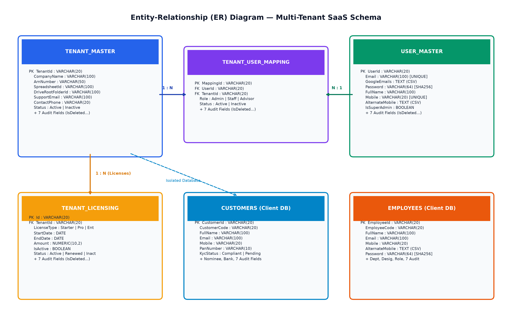

# DFD & Entity-Relationship (ER) Documentation

**Document ID:** `DIAG-CRM-SAAS-01`  
**Version:** `v2.5 (Production Live)`  
**Format:** Markdown Companion (Full Word document: [`04_DFD_And_ER_Diagrams.docx`](./04_DFD_And_ER_Diagrams.docx))

---

## 1. Data Flow Diagram (DFD) — Level 0 Context Diagram


### External Entities:
1. **CRM Founder / SuperAdmin:** Manages tenant onboarding, subscription renewals, system settings.
2. **Tenant Org Admin:** Manages organization staff, customer assignments, reports.
3. **Investment Advisor / Staff:** Conducts customer onboarding, KYC registration, SIP calculations.
4. **Investor / Client Lead:** Receives portfolio statements, provides KYC documentation.

---

## 2. Data Flow Diagram (DFD) — Level 1 Process Decomposition


### Key Processes:
- **1.0 User Authentication:** Verifies Google GIS tokens or SHA-256 credentials against `User_Master`.
- **2.0 Workspace Routing:** Checks `Tenant_User_Mapping` and routes to direct workspace or multi-org picker.
- **3.0 SaaS Provisioning:** Creates new tenants in `Tenant_Master` and logs licenses in `Tenant_Licensing`.
- **4.0 Investor Management:** Manages customer records, nominees, and portfolio valuations.
- **5.0 Staff & RBAC Engine:** Enforces permissions across modules.
- **6.0 Drive File Isolation:** Routes document uploads to client-specific `DriveRootFolderId`.

---

## 3. Entity-Relationship (ER) Schema Diagram



### Relational Schema & Cardinality:

```
TENANT_MASTER (1) ──────────< (N) TENANT_USER_MAPPING (N) >────────── (1) USER_MASTER
      │                                                                      │
      │ (1)                                                                  │ (1)
      │                                                                      │
      ▼ (N)                                                                  ▼ (N)
TENANT_LICENSING                                                        USER_DOCUMENTS
      │
      │ (Logically isolates)
      ▼
CUSTOMERS & EMPLOYEES (Per-tenant cloned Database)
```

### Table Relationships:
- `TENANT_MASTER` &rarr; `TENANT_USER_MAPPING`: 1 to Many (A tenant can have multiple employees/admins).
- `USER_MASTER` &rarr; `TENANT_USER_MAPPING`: 1 to Many (A single user identity can belong to multiple tenants).
- `TENANT_MASTER` &rarr; `TENANT_LICENSING`: 1 to Many (Historical subscription log per organization).
- `TENANT_MASTER` &rarr; `CUSTOMERS` / `EMPLOYEES`: 1 to Many (Logical partition via `SpreadsheetId`).

